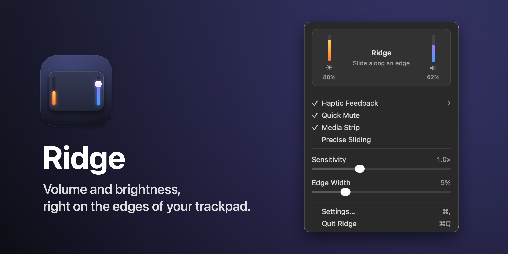
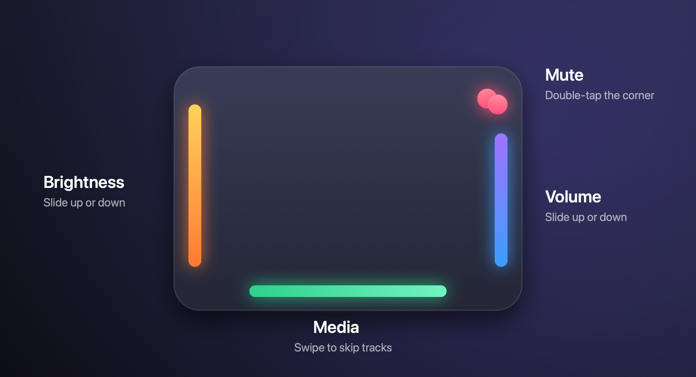
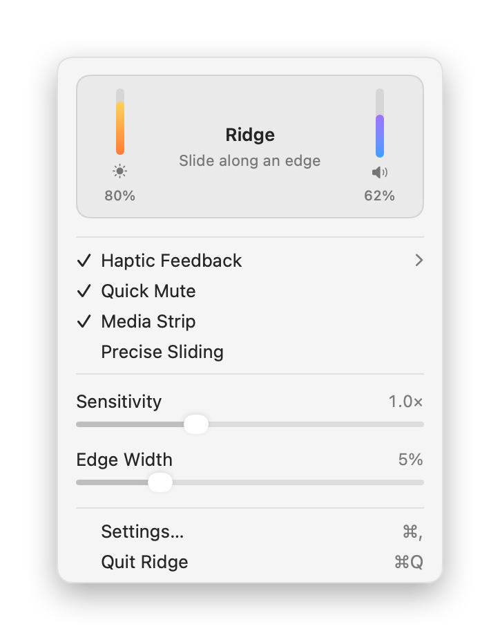
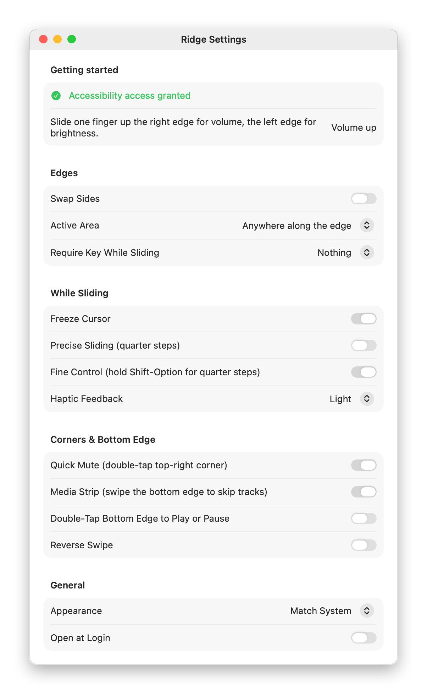

<p align="center">
  
</p>

# Ridge

Ridge turns the edges of your Mac's trackpad into volume and brightness sliders.

Run a finger up the right edge and the volume goes up. The left edge does brightness. You get the usual macOS volume and brightness pop-up, a small haptic tick on every step, and your cursor stays where it is while you slide.

**[Download Ridge 1.0.0](https://github.com/gundaIf/ridge/releases/latest)** · macOS 13 or later · Apple Silicon and Intel · free

<p align="center">
  
</p>

## What it does

- **Volume** on the right edge, **brightness** on the left. Swap Sides flips them.
- **Double-tap the top-right corner** to mute or unmute.
- **Swipe along the bottom edge** to skip to the next or previous track. You can also turn on double-tap to play or pause.
- **Quarter steps** for fine adjustments. Turn on Precise Sliding, or hold Shift-Option while you slide.
- **Haptic feedback** on every step, with a stronger buzz when you mute.
- **Cursor freeze**, so the pointer stays where it is while you adjust.
- Lives in the menu bar. No Dock icon, and it uses almost no CPU.
- Keeps working after your Mac wakes up or a Magic Trackpad reconnects.

## Screenshots

The menu shows your current brightness and volume on the edges that control them.

<p align="center">
  <picture>
    <source media="(prefers-color-scheme: dark)" srcset="docs/menu-dark.png">
    
  </picture>
  <picture>
    <source media="(prefers-color-scheme: dark)" srcset="docs/settings-dark.png">
    
  </picture>
</p>

## Install

1. Download `Ridge-1.0.0.zip` from [Releases](https://github.com/gundaIf/ridge/releases/latest), unzip it, and drag **Ridge** into Applications.
2. Open it. Ridge isn't notarized by Apple, so macOS will block it the first time. Go to **System Settings → Privacy & Security**, scroll down, and click **Open Anyway**. If you'd rather use Terminal:
   ```bash
   xattr -dr com.apple.quarantine /Applications/Ridge.app
   ```
3. When it asks, give Ridge **Accessibility** access. It needs that to send the volume and brightness keys. Nothing leaves your Mac.

Then slide a finger along an edge. The Settings window shows the last gesture Ridge picked up, so you can tell right away that it's working.

## Settings

| Where | Setting | What it does |
| --- | --- | --- |
| Menu | Haptic Feedback | Off, Light, Medium or Strong |
| Menu | Quick Mute, Media Strip, Precise Sliding | Turn each gesture on or off |
| Menu | Sensitivity | How far you slide for each step |
| Menu | Edge Width | How wide the edge zones are (5% by default) |
| Settings | Swap Sides | Volume on the left, brightness on the right |
| Settings | Active Area | Only start slides from the bottom ¾, half or quarter of the edge |
| Settings | Require Key | Only slide while holding Fn or Option, to avoid accidental slides |
| Settings | Freeze Cursor | Hold the pointer still while sliding |
| Settings | Appearance, Open at Login | Light or dark menu, start with your Mac |

## Build it yourself

You need the Swift toolchain. The Xcode Command Line Tools are enough.

```bash
git clone https://github.com/gundaIf/ridge.git
cd ridge
./build.sh
open Ridge.app
```

`./build.sh --zip` also packs a release zip. `Ridge --snapshot docs` re-renders the icon and the images in this README from the real views.

## How it works

macOS doesn't have a public API for raw trackpad touches, so Ridge reads them from Apple's private `MultitouchSupport` framework. It loads the framework at runtime from a small C bridge in `Sources/CMultitouch`. `Engine.swift` turns finger positions into slides, taps and swipes. Volume and brightness change by sending the same media key events your keyboard sends, which is why you get the native pop-up. The haptic ticks come straight from the trackpad's actuator.

## Known quirks

- If you use tap to click, double-tapping the mute corner also clicks whatever is under the pointer.
- Brightness only controls the built-in display.
- Because it relies on a private framework, a future macOS update could break it. If that happens, open an issue.

## License

[MIT](LICENSE)
